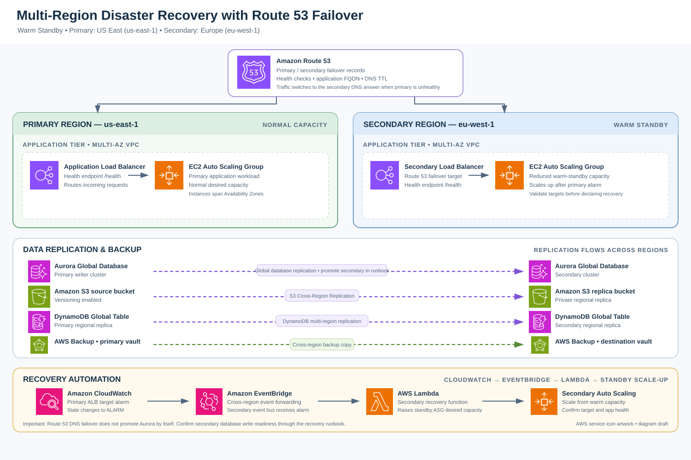

# Kubernetes Disaster Recovery Platform

A Terraform-based AWS project demonstrating backup and recovery for a stateful Kubernetes workload. It provisions core networking and Amazon EKS resources and documents how to configure Velero and validate a backup/restore drill.

> **Scope:** This repository describes a single-region Kubernetes workload-recovery design in eu-central-1. It is not a multi-region Route 53 failover deployment. The architecture diagram is manually composed using official AWS Architecture Icons; it is not an AI-generated flow diagram.

## Solution Architecture

Editable diagram: [Open the Draw.io source](docs/architecture.drawio). See [Architecture Notes](docs/architecture.md) and the [Disaster Recovery Runbook](docs/disaster-recovery-runbook.md).

## Objectives

- Provision networking, EKS, IAM, ECR, and S3 resources using Terraform.
- Run a Flask API with PostgreSQL state on Amazon EKS.
- Use an EBS-backed PersistentVolumeClaim for PostgreSQL data.
- Configure Velero to back up Kubernetes resources to S3 and protect volume data with the configured snapshot mechanism.
- Use IAM Roles for Service Accounts (IRSA) rather than mounting long-lived AWS credentials in cluster pods.
- Validate infrastructure formatting, Python smoke tests, and the Docker build in GitHub Actions.
- Record measured recovery evidence instead of presenting estimates as completed test results.

## Technology Stack

| Area | Technology |
|---|---|
| Infrastructure as Code | Terraform |
| Networking | Amazon VPC, public/private subnets, route tables, Internet Gateway, NAT Gateway |
| Container orchestration | Amazon EKS, kubectl, Helm |
| Application | Flask API, PostgreSQL |
| Persistent storage | Amazon EBS, EBS CSI driver, Kubernetes PVC |
| Backup and recovery | Velero, Amazon S3, EBS snapshots when configured |
| Container registry | Amazon ECR |
| Identity | AWS IAM, EKS OIDC provider, IRSA |
| CI | GitHub Actions |

## Repository Structure

~~~text
.
├── .github/workflows/ci.yml
├── app/
│   ├── app.py
│   ├── Dockerfile
│   ├── requirements.txt
│   └── test_app.py
├── docs/
│   ├── architecture.md
│   ├── architecture.svg
│   ├── architecture.drawio
│   ├── disaster-recovery-runbook.md
│   └── validation-status.md
├── k8s/
│   ├── demo-app/
│   │   ├── namespace.yaml
│   │   ├── storageclass.yaml
│   │   ├── flask-app.yaml
│   │   └── postgres.yaml
│   └── velero/values.yaml
└── terraform/
    ├── environments/prod/
    └── modules/
        ├── eks/
        ├── iam/
        ├── s3/
        └── vpc/
~~~

The repository also contains a bundled Velero release archive from the original project. The reproducible installation path documented here uses Helm and the AWS plugin; the archive is not referenced by the application or its Kubernetes manifests.

## Infrastructure

Terraform modules describe the following resources:

- VPC with public and private subnet sets across two Availability Zones, an Internet Gateway, NAT Gateway, and route tables.
- EKS cluster and managed node group.
- IAM roles for the cluster and worker nodes.
- EKS OIDC provider and dedicated IRSA roles for the EBS CSI driver and Velero.
- EBS CSI EKS add-on and a gp3 StorageClass for persistent-volume provisioning.
- S3 bucket with versioning, server-side encryption, and public-access blocking.
- Private ECR repository with image scanning on push.

The environment is configured for eu-central-1. Inspect the Terraform plan before applying: EKS and a NAT Gateway can incur ongoing AWS charges. Review and restrict the EKS public endpoint CIDRs and IAM permissions for your account before using this beyond a disposable demo environment.

## Application

The demo API provides a health response and basic user-record endpoints backed by PostgreSQL. The Kubernetes manifests are in k8s/demo-app. PostgreSQL runs in a StatefulSet and uses a PersistentVolumeClaim intended to be backed by EBS through the EBS CSI driver.

Database credentials are not stored in the repository. Create the postgres-secret in the demo-app namespace as described in the runbook. Replace ACCOUNT_ID in the Flask deployment image with the AWS account ID after publishing the container to ECR.

## Backup and Recovery

The Velero Helm values template is in k8s/velero/values.yaml. Before installing it, replace the bucket and role placeholders with the Terraform output values and ensure the AWS plugin version matches the Velero version installed.

The [runbook](docs/disaster-recovery-runbook.md) documents how to:

1. Validate and provision the infrastructure.
2. Deploy the demo workload and create its database Secret securely.
3. Configure Velero's S3 BackupStorageLocation and EBS snapshot location.
4. Insert a known database record and create a named backup.
5. Inspect backup status and confirm the persistent-data recovery path.
6. Delete only the disposable demo-app namespace after checking the backup.
7. Restore the namespace and verify the API, database, PVC, and original test record.
8. Record timestamps and compute measured recovery metrics.

### RTO and RPO

- **RTO (Recovery Time Objective):** elapsed time from the defined disruption until the application is verified healthy again.
- **RPO (Recovery Point Objective):** age of the most recent application data that is confirmed recoverable at the disruption time.

No new AWS provisioning or destructive restore drill was executed during this repository update. Do not report a specific RTO, RPO, resource count, or data-integrity percentage until you have run the drill and recorded evidence in docs/validation-status.md.

## CI/CD

GitHub Actions runs Terraform format/validation checks, Python smoke tests, and a Docker build on pushes and pull requests. An optional workflow-dispatch input can publish the image to ECR using GitHub OIDC. Publishing requires an AWS role configured for GitHub's OIDC provider and the repository variable AWS_ROLE_TO_ASSUME; ordinary validation does not require AWS credentials.

## Security and Cost

- Never commit AWS access keys, kubeconfig files, Terraform state, database passwords, or real backup data.
- Prefer GitHub OIDC federation over long-lived AWS access keys.
- Review EKS endpoint exposure, IAM policies, Kubernetes Secrets, and network ingress rules.
- Keep destructive recovery drills within the demo-app namespace on a disposable cluster.
- Review Terraform plans before apply and remove test resources when no longer needed.

## Evidence and Limitations

The repository contains a [validation evidence template](docs/validation-status.md). It is intentionally blank until tests are run. A diagram, Terraform definition, or README statement does not prove that resources are deployed or that a restore has succeeded.

Future improvements include tested backup retention, automated backup-failure alerts, additional application integration tests, and regional recovery only if that scope is explicitly selected and implemented.

## Project Author

Khaled Elnabawy — Junior DevOps Engineer
